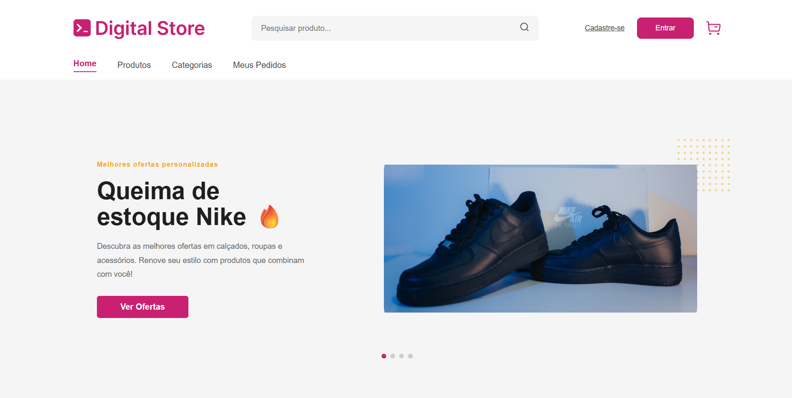
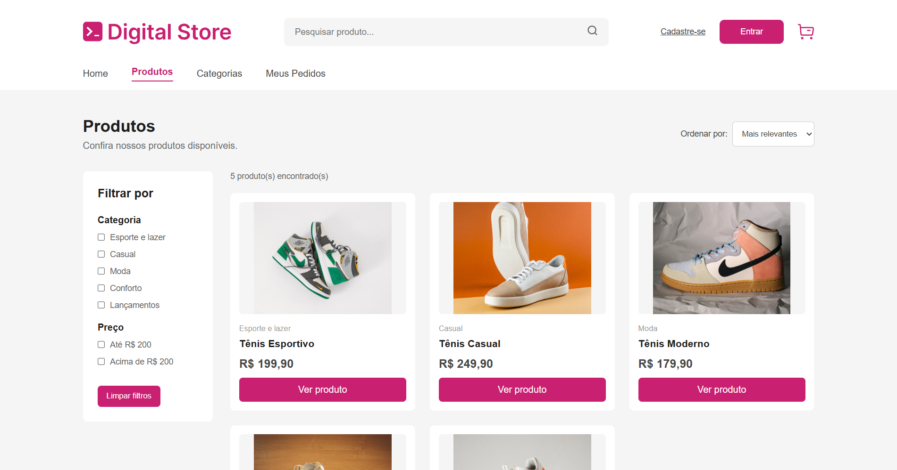
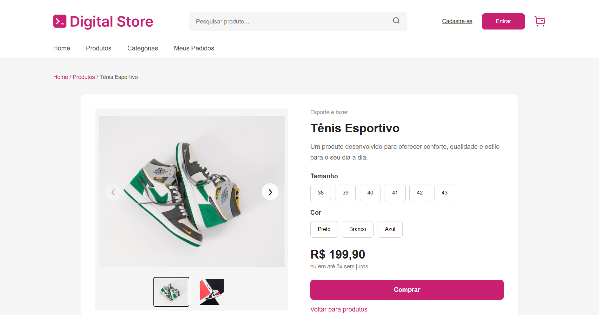

# Digital Store 

Olá! Meu nome é **Hillary Alcântara** e este é o meu projeto de Front-end desenvolvido durante o curso **Geração Tech – Desenvolvimento Full Stack**.

##  Sobre o projeto

A **Digital Store** é uma aplicação de loja virtual desenvolvida com React. O projeto tem como objetivo colocar em prática os conhecimentos adquiridos durante o curso, trabalhando com criação de componentes, organização de páginas, estilização e navegação entre telas.

A aplicação apresenta uma interface de e-commerce, permitindo visualizar produtos, utilizar filtros, ordenar itens e acessar os detalhes de cada produto.

## Tecnologias utilizadas

- React
- JavaScript
- HTML5
- CSS3
- Vite
- React Router DOM

##  Funcionalidades

- Página inicial com banner e produtos em destaque.
- Exibição de produtos em cards.
- Página de listagem de produtos.
- Filtros por categoria e faixa de preço.
- Ordenação de produtos por preço.
- Página de detalhes dos produtos.
- Seleção de tamanho e cor.
- Produtos recomendados.
- Navegação entre páginas.

##  Demonstração

Acesse a versão publicada do projeto:

**[🔗 Clique aqui para acessar a Digital Store](https://digital-store-095q.netlify.app/)**

##  Telas do projeto

### Página inicial

### Página de produtos

### Detalhes do produto

## 👩‍💻 Desenvolvedora

**Hillary Alcântara**

Projeto desenvolvido como atividade prática do curso **Geração Tech – Desenvolvimento Full Stack**.

---

Obrigada por visitar meu projeto!
